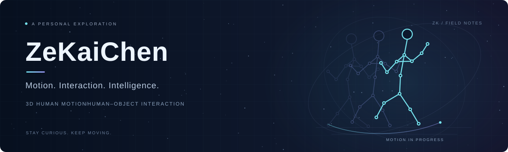

  

<h3 align="center">从理解人的动作，到探索具身智能</h3>

Understanding human motion. Exploring embodied intelligence.

中山大学软件工程学院 · 2025级本科生 School of Software Engineering, Sun Yat-sen University · Undergraduate, 2025 intake

---

### About me · 关于我

Hi, I'm **ZeKaiChen (Jacky / 陈泽楷)**, an undergraduate at the **School of Software Engineering, Sun Yat-sen University**. I am conducting undergraduate research at the [**Intelligence Science and System Lab (iSEE)**](https://www.isee-ai.cn/), supervised by [**Prof. Wei-Shi Zheng**](https://www.isee-ai.cn/~zhwshi/).

你好，我是 **陈泽楷（ZeKaiChen / Jacky）**，中山大学 **软件工程学院2025级本科生**，目前在 [**智能科学与系统实验室（iSEE）**](https://www.isee-ai.cn/)参与本科生科研，导师为 [**郑伟诗教授**](https://www.isee-ai.cn/~zhwshi/)。

My current research focuses on **3D human motion generation** and **human–object interaction (HOI)**. I am working on model improvements and experimental evaluation, exploring how to better model the relationship between human movement and object behavior.

目前，我主要研究 **三维人体动作生成与人—物交互**，正在进行模型改进和实验验证，关注如何更好地建模人与物体之间的运动关系与交互合理性。

### How I got here · 从体育科技到动作研究

My interest in human motion grew out of a **summer 2026 internship at SHOTLAB**, where I worked on human pose research in sports technology. Working with motion capture and RGB-D data gave me an entry point into 3D human pose and reconstruction, and I have continued exploring this area through my current research.

我对人体动作研究的兴趣，源于 **2026年暑期在 SHOTLAB 的体育科技实习**。当时参与了人体姿态相关研究，接触了动捕与 RGB-D 数据，以及三维人体姿态和重建。这段经历让我对这一方向逐渐熟悉，也成为继续探索三维人体动作研究的起点。

### Research interests · 研究与兴趣

- **3D Human Motion & HOI — current focus.** Human motion generation, human–object motion relationships, and model improvement through experiments. **三维人体动作与人—物交互：当前方向。** 关注人体动作生成、人与物体的运动关系，以及通过实验推进模型改进。
- **World Models — a direction I want to explore.** I'm curious about how models learn to represent and predict the physical world, and how those predictions can support action. **世界模型：希望进一步探索。** 对模型如何表征、预测物理世界，以及如何利用预测支持行动感兴趣。
- **Humanoid Robotics & Embodied AI — longer-term interests.** I'd like to connect my interest in human motion with how embodied agents perceive, act, and interact. **人形机器人与具身智能：长期兴趣。** 希望从对人体动作的理解出发，逐步探索具身智能体的感知、行动与交互。

### Beyond research · 科研之外

On the court, I usually play **guard**, and I'm a **Stephen Curry** fan. Off the court, I'm optimistic, goal-oriented, and enjoy exchanging ideas. Always happy to talk about papers, experiments, or basketball. 🏀

球场上主要打 **后卫**，是 **斯蒂芬·库里** 的球迷。球场之外，我比较乐观、有目标感，也喜欢和别人交流想法。欢迎来聊论文、实验，或者篮球。🏀

### Get in touch · 联系我

- **University email · 校内邮箱：** [chenzk35@mail2.sysu.edu.cn](mailto:chenzk35@mail2.sysu.edu.cn)
- **Personal email · 个人邮箱：** [2719964934@qq.com](mailto:2719964934@qq.com)

---

Stay curious. Keep moving. · 保持好奇，继续向前。

